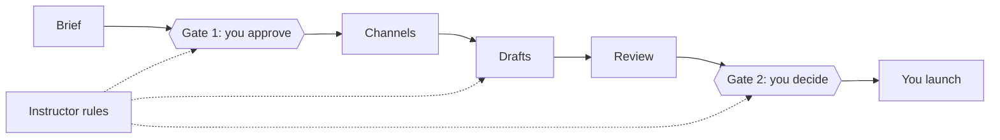

# CXL Campaign Engine

The [CXL Personal OS](https://github.com/conversionxl/cxl-personal-os) with the Campaign Engine module built in. Built for the CXL AI Native Marketer cohort, with Tyler Durman.

**Brief in, reviewed campaign out.** You write or adjust a campaign brief with Claude and approve it. You pick the channels, and Claude walks you through each one's step-by-step workflow, built from CXL courses, so you can adjust it to your campaign and your tools. Claude then drafts every channel by following your version, pausing wherever a person decides. A weighted quality gate scores every draft against the brief and your criteria, and you accept or fix what it flags. Two human gates, nothing in between ships on vibes. Run as many campaigns as you like: each lives in its own folder, and one board tracks them all.

It stacks with the [Marketing Brain](https://github.com/conversionxl/cxl-marketing-brain): if you built a brand brain in `wiki/brand/`, the engine reads it. If not, the brief collects the minimum itself. Neither module needs the other.

## Plugin or repository: pick one

This repository is two different things, and you use **one of them per folder**:

| | The **campaign-engine** plugin (recommended) | The starter repo |
|---|---|---|
| What it is | The Campaign Engine commands and skills, installed into Claude | The personal OS with the Campaign Engine built in, as a folder of files |
| How you get it | Install it from **Settings → Plugins** in Claude (below). **Don't download or clone this repository** | **Use this template** to make your own private copy (see [Set up](#set-up-10-minutes)) |
| Your work lives in | A folder of your own, where you run `/campaign-engine:setup` | Your copy of the repo |
| Needs | Claude (desktop app, Cowork, VS Code or terminal) | Claude Code in VS Code or a terminal |

**Installing the plugin is not the same as downloading this repository.** A downloaded or cloned copy of this repository is the starter repo, not the plugin: Claude doesn't load it as a plugin, and `/campaign-engine:...` commands don't appear. Opening that copy *and* installing the plugin gives you every command twice.

Already set up the personal OS repo and want to keep your logs and projects? Skip to [Add the module to your existing repo](#add-the-module-to-your-existing-repo).

## Plugin route

Works in any folder. For daily logs, memory and the personal OS commands, also set up the **personal-os** plugin with `/personal-os:setup` (see [its README](https://github.com/conversionxl/cxl-personal-os-plugins)). For a brand brain, the **marketing-brain** plugin (`/marketing-brain:setup`). Both are recommended, not required.

1. In Claude (claude.ai or the desktop app), open **Settings → Plugins**, click **Add → Add marketplace**, and choose the GitHub repo option. Enter `conversionxl/cxl-campaign-engine`, then add **Campaign engine**. It then shows under **From marketplaces you added**. This is its own marketplace, separate from the ones you added for personal-os.
2. Open your personal OS folder in Cowork, or in the desktop app's Code tab with Environment: Local, and type `/campaign-engine:setup`. Use the same folder for every module, so the engine reads your brand brain. Setup then coaches you through brief, channels, drafts and review, on the Acme example, a campaign you make up, or your own. Type it again any time: it picks up where you left off.

The plugin is saved to your claude.ai account and Claude syncs it to chat, Cowork, the desktop app, VS Code and the terminal. You install it once, and you never download this repository for it.

**Only if you can't use Settings → Plugins:** in the Claude chat in VS Code or a terminal (start `claude` first), type `/plugin marketplace add conversionxl/cxl-campaign-engine`, then `/plugin install campaign-engine@cxl-campaign-engine`. This makes a second, local copy on this computer only. Never use it as well as the Settings → Plugins route.

Setup adds `raw/campaigns/`, `projects/campaigns/` with an empty campaigns board, your own copy of the default quality gate in `projects/campaign-engine/`, the eight starter channel workflows, the frameworks, the project file, and a Campaign Engine section in your `CLAUDE.md`. It never overwrites a file, and it adds the `.gitignore` rule that keeps your campaign data local before anything lands in `raw/campaigns/`. The commands are then `/campaign-engine:campaign-brief`, `campaign-channels`, `campaign-draft`, `campaign-review`, `quality-gate` and `campaigns`, and the skills load by themselves.

### Troubleshooting: a local copy and a synced copy

| Copy | How it got there | Listed in `/plugin` as |
|---|---|---|
| **Synced** (the one to keep) | Added in **Settings → Plugins** on claude.ai or the desktop app | `campaign-engine@synced` |
| **Local** | Typed `/plugin marketplace add` and `/plugin install` in a terminal or VS Code | `campaign-engine@cxl-campaign-engine` |

- **Every `/campaign-engine:` command listed twice?** You have both. Keep the synced copy. Ask Claude: *"Remove the local copy of the campaign-engine plugin and its cxl-campaign-engine marketplace. Keep the synced one."* Then fully quit and reopen Claude. (By hand: `/plugin uninstall campaign-engine@cxl-campaign-engine`, then `/plugin marketplace remove cxl-campaign-engine`.)
- **Commands listed both as `/campaign-brief` and `/campaign-engine:campaign-brief`?** You opened a copy of this repository and installed the plugin too. Pick one: either work in your own folder with the plugin, or in your copy of the starter repo without it.
- **Not showing up after you added it?** After you add the marketplace, the plugin isn't installed until you click **Add** next to it. This step is easy to miss. In VS Code or the terminal, the sync can take a few minutes: fully quit and reopen. Don't fix it by adding the local copy: that's how you end up with two.


## Set up (10 minutes)

**1. Make your own private copy.** Your logs, projects and campaigns are private, so do not work in a public fork. (No GitHub? Click **Code → Download ZIP** and unzip it. Everything works on one machine; see [Without GitHub](#without-github).)
- Click **Use this template → Create a new repository**, choose **Private**, and create it.
- Clone your new repo and open the folder:
  ```bash
  git clone https://github.com/<you>/<your-repo>.git
  cd <your-repo>
  ```

**2. Install the prerequisites.**

| Tool | Why | macOS | Windows |
|---|---|---|---|
| [Claude Code](https://docs.claude.com/en/docs/claude-code/overview) | Runs everything | `curl -fsSL https://claude.ai/install.sh \| bash` | See the install docs |
| `jq` | Every hook needs it | `brew install jq` | `winget install jqlang.jq` |
| `gh` (optional) | Pushing to GitHub from `/shutdown` | `brew install gh` | `winget install GitHub.cli` |

Without `jq` the daily logs are not written automatically. A health-check hook warns you at session start if it is missing, and `/start` walks you through the fix.

**Windows:** install Git for Windows (`winget install Git.Git`) and `jq`, then fully quit and reopen VS Code so the new PATH is picked up. If you cannot install software on your laptop, the repo still works: run `/shutdown` at the end of each session and it writes the daily log without hooks.

**3. Start Claude Code in the folder and run `/start`.**
```bash
claude
```
```
/start
```
**Using Cowork instead?** Point Cowork at the folder and ask: *"Run the start command from `.claude/commands/start.md`"*. Cowork does not show repo commands as `/` commands, so run each one by asking for it this way.

`/start` checks your setup, links memory, explains the system, fills in the "About me" section of `CLAUDE.md`, and creates your first project files.

**4. (Optional) Open the folder as an Obsidian vault** to browse your notes, follow `[[wikilinks]]`, and see the backlinks graph.

## Add the module to your existing repo

Already running your own copy of the personal OS or the Marketing Brain? Open it in Claude Code and paste this prompt. It copies the module in and merges your `CLAUDE.md` rather than overwriting it. Your logs, projects, memory and brand brain are not touched.

```
Add the CXL Campaign Engine module to this repo from
https://github.com/conversionxl/cxl-campaign-engine. Show me the plan before changing anything.

1. Run: git remote add campaign-engine https://github.com/conversionxl/cxl-campaign-engine
   then: git fetch campaign-engine
   (No git? Download the ZIP from that page, unzip it next to this repo, and copy from there.)
2. Append the "Campaign Engine" block from the end of its .gitignore to mine, below my *.csv rule,
   BEFORE copying anything into raw/campaigns/. Skip the raw/voc, raw/strategy and raw/performance
   lines if I already have them.
3. Copy these paths from campaign-engine/main, skipping any file I already have:
   .claude/commands/campaign-brief.md, .claude/commands/campaign-channels.md, .claude/commands/campaigns.md,
   .claude/commands/campaign-draft.md, .claude/commands/campaign-review.md,
   .claude/commands/quality-gate.md, .claude/skills/campaign-engine/, .claude/skills/quality-gate/, .claude/skills/keep-it-compact/,
   raw/campaigns/, projects/campaigns/, projects/campaign-engine/,
   frameworks/campaign-brief-template.md, frameworks/workflow-format.md, frameworks/workflows/,
   frameworks/quality-gate.md, frameworks/campaign-inputs.md, frameworks/decision-models.md,
   frameworks/campaigns-board.md, frameworks/battlecard.md
4. Copy frameworks/quality-gate.md to projects/campaign-engine/quality-gate.md (my copy to edit) and
   create projects/campaign-engine/workflows/ (empty: my channel defaults are saved there later),
   skipping anything I already have.
5. Merge into my CLAUDE.md, never overwriting my own text: its "Campaign Engine" section,
   its three new rows in the folder table, and its five new rows in the commands table.
6. In my .claude/commands/ingest.md, make step 1 skip raw/campaigns/, as the module's version does.
7. Show me git status, then remove the campaign-engine remote.
```

## Updating

New versions don't install themselves on a personal marketplace. To update: **Settings → Plugins → Add → Manage marketplaces → ⋮** next to the marketplace → **Check for updates**. Your folder, logs, campaigns, quality gate and saved default workflows are untouched. (Automatic sync needs the Claude GitHub App to have access to the repo; that is not set up.)

**New in 0.16.1:** the Google Ads starter is rebuilt on Jack Paxton's CXL course, Validate and Scale Your Google Ads: budget tiers, the 60/30/10 split, match types and brand share, bid thresholds, headline jobs, landing page fixes before spend, and when to step in.

**New in 0.16.0:** word budgets allow 10% over without a flag, so pages are no longer trimmed and re-checked in a loop; `/campaign-engine:campaigns page <campaign> share-safe` builds a page with real names swapped for stand-ins, from a list that stays on your machine, kept through every rebuild; and the review writes approval messages for the people who sign off on pieces, for you to send.

**New in 0.15.0**, the drafting craft members added by hand:
- **A Google Ads starter** for B2B search, built from Jack Paxton's CXL course, Validate and Scale Your Google Ads.
- **A page pack on every landing page:** URL, title tag, meta description, Open Graph, schema, sections that stand on their own for AI answers, message match and a conversion target.
- **One tracking convention:** every link carries full UTMs (campaign slug, platform, channel, piece ID) and jump links use the page's anchors.
- **Match your existing copy:** drop approved copy or live pages in `raw/campaigns/approved-copy/`. An optional copy style sits beside the brand voice, and copy in another language gets an English summary for the team.
- **After Gate 2:** a load sheet per tool, field by field, a creative handoff for the pieces with a visual, and a weekly results routine that checks the kill and scale rules.
- Ads add a matched audience from your own list, sales enablement checks what ChatGPT and Claude say about you before the first send, and a one-channel campaign gets a suggestion for more mileage.

**New in 0.14.0**, for smaller teams and longer runs:
- **A balanced mode**, now the default for your own campaigns: Claude stops only where a mistake costs money or a relationship (the budget, the offer, who gets contacted, anything before it goes out) and makes the other calls for you to check at the review.
- **Your team size counts:** on your own, the named roles in the workflows become you and the handoffs between people are merged.
- **`/campaign-engine:campaigns resume`** picks up a campaign where the last session stopped, and each step says where you are and which files it wrote.
- **`/campaign-engine:campaign-channels default <channel>`** changes your default workflow without starting a campaign. Defaults are yours: plugin updates never change them.
- Setup offers to bring over work from folders you cloned or downloaded separately.

**New in 0.13.0**, rows for the misses the reviews caught by hand:
- **Checks across the campaign:** the budgets add up, the offer in the ads and emails matches the landing page, and every CTA lands on the destination.
- **Platform rules and compliance:** a Regulated line in the brief switches on a check for special ad categories (Meta locks age and postcode targeting for housing, for example) and a compliance check for regulated industries.
- **A proof plan instead of a dead end:** a message with no proof gets a plan to collect it, added to the launch tasks.
- **Gate 1 also checks** thin evidence (most proof from one or two customers) and a big-C goal planned as one small-c set of pieces. Ad tests keep spare drafts for the next test, and LinkedIn messages open with relevance and leave the pitch for later.

**New in 0.12.0**, because members found the review heavy to read:
- **The campaign page has new tabs:** Brief, Touchpoints (where and when each piece reaches the buyer), Content (every piece shown as it will look, with its review inside it), Workflow (the steps, launch tasks and notes), Results. Pages made earlier are rebuilt on these tabs at their next update.
- **The review leads with the top three fixes**, then the scores, with Claude's score labelled as a self-review next to the decision models and you.
- **Pieces you built elsewhere** (a page in your CMS, ads in Figma or Canva) can be linked to the campaign with "link <piece> <URL or file>", and the review checks them.

**New in 0.11.0**, because the most reported problem was hours of back and forth before the first draft:
- **Fast or full, per campaign.** `/campaign-brief` asks once. Fast: Claude makes the calls at the steps you own and lists every one first in the review, for you to keep or change at Gate 2 (about 90 minutes, brief to review). Full: Claude stops at each of those steps and decides with you (about two hours). Example and practice runs default to fast. Both stop at the two gates, and neither sends anything.
- **One round of questions per step**, with a suggested answer where Claude can make one, and assumptions tagged (inferred) instead of asked.
- **Launch tasks.** Steps that need the built page, a loaded email or a running ad (marked "at launch" in the starters) go on a list in the draft instead of stopping it.

**New in 0.10.0**, from the review of 28 cohort demos and members' feedback on the brief:
- **A new brief layout** in seven sections: goal and metrics, audience, offer and proof, messages, campaign structure, sales handoff, constraints. It asks why now and why you over each alternative, proposes key messages for you to choose from, works back from the goal to weekly volume, and sets kill and scale rules on early signals. Briefs you already wrote keep their layout until you ask to move them.
- **Gate 1 checks the gaps the reviews found** (22 checks, up from 16), and Gate 2 adds three rows: one specific CTA, offer claims proven, named alternatives answered. Your own copy of the gate keeps your weights: `/campaign-review` offers to add the new rows.
- **Landing pages come out as a laid-out HTML mock-up**, linked from the campaign page, not only as copy in sections. A landing page workflow you saved as your default keeps your steps; copy the mock-up step from the starter to get it.

## Linked campaigns

Campaigns can belong together. A **sub-campaign** sits inside its main campaign's folder: the November sprint inside a bigger push to make CXL the leader in AI training for marketers. Campaigns that run **alongside** each other keep their own folders and link both ways: the webinar series feeds the sprint. `/campaign-brief` asks about both, reads every linked brief, and every campaign page shows the family, with the scale badge (small-c or big-C) next to each name. Rules and folder layout: `frameworks/linked-campaigns.md`.

## What you bring, what Claude asks

Setup takes one command. The back and forth happens inside each step, and it is short by design: Claude reads what it can find first, then asks only for what is still missing.

| Step | Bring this (drop it in `raw/campaigns/` or paste it in the chat) | Claude asks | Who else is involved |
|---|---|---|---|
| Brief | The goal and its date, last campaign's readout, proof you are allowed to use, the budget, the competitors buyers mention | Up to nine questions, three per message, numbered so you can answer "1: 70 sales by 10 Nov, 3: existing customers". Skipped when your brand brain, daily logs, files or a connected tool already answer them | Sales agrees the lead definition and the handoff in writing before you approve |
| Channels | The tools you send with (email tool, CMS, ad accounts) | One question per channel for the tool, then "anything to change or skip?" on a short list of steps | Nobody yet |
| Drafts | Your call at every step marked "You" | It stops at each one and waits | The sales lead approves the enablement assets; a designer or Claude Design makes the ad creative |
| Review | Accept, fix or overrule each flag | One list of recommendations, each with a prompt to fix it | Whoever signs off the claims |

**Good input, fast.** Drop files in before you run a command, not halfway through. "Don't know" and "skip" are fine answers: the line is tagged (inferred) and Gate 1 tells you which ones matter. Claude never contacts your team; the brief names who signs off what, and you take it to them.

## The Campaign Engine

| | Step | Run | You bring | It writes |
|---|---|---|---|---|
| 1 | Brief, Gate 1 | `/campaign-brief` | Past briefs, results and sales feedback in `raw/campaigns/`; your answers to up to nine questions (budget, competitors and why now included); a brand brain if you have one | `projects/campaigns/<slug>/brief.md`, approved by you |
| 2 | Channels | `/campaign-channels <slug>` | Which channels, then keep, change or cut each step for your campaign and tools; any other channel, your steps or a suggestion | `projects/campaigns/<slug>/workflows/<channel>.md`, and your default if you say so |
| 3 | Drafts, then review | `/campaign-draft <slug>` | Your decisions at every human pause | `projects/campaigns/<slug>/drafts/<channel>.md`, then the review runs on its own |
| 4 | Review, Gate 2 | Automatic after drafts; `/campaign-review <slug>` to score again after edits | Your accept, fix or overrule per flag | `projects/campaigns/<slug>/review.md` |
| + | Tune the gate | `/quality-gate` | Your channels, your last campaign that missed its goal, your sign-off rules | `projects/campaign-engine/quality-gate.md` |
| + | Track them all | `/campaigns` | Results from connected tools, or the number; the lesson when one closes | `projects/campaigns/campaigns.md` and a board page |

**Before the workshop**, fill the inputs. The checklist is in `projects/campaign-engine/campaign-engine.md`, and `raw/campaigns/README.md` says what goes in.

- `raw/campaigns/` holds your campaign history and **stays on your machine**: it is gitignored. Client briefs under NDA are fine there.
- `projects/campaigns/` holds briefs, drafts and reviews and **is committed**: decisions and copy, never customer lists or personal data.

**No campaign data?** Every command takes `example`: `/campaign-brief example` runs on Acme Deals, a fictional lifetime-deal marketplace with two past briefs, last quarter's results, a CRM snapshot, sales feedback and a filled brand brain. Example runs write to `projects/campaigns/example-*/`, so your own campaigns stay clean.

**The rules that run through all of it:** the brief holds decisions and no copy; every line traces to a source or is tagged **(inferred)**; every claim in a draft traces to proof or is cut; every CTA moves the buyer to the goal, not to the asset; your workflow beats the default; and a human approves at both gates.

## Where you decide

Claude drafts; it never ships. You decide at Gate 1 (the brief), at every step marked "You" in a channel's workflow (30 of the 121 starter steps), and at Gate 2 (the review). Rules from CXL instructors sit in every step and in the quality gate, so a draft that breaks one is flagged. The full map, with a diagram: `frameworks/human-checks.md`.



## The quality gate

`frameworks/quality-gate.md` is a sheet: 24 pass-or-fail checks for the brief, then 52 criteria and 3 checks across the campaign × 7 channels × a weight of 0 to 3 for the drafts, with SHIP, REVIEW and FIX thresholds and must-pass rows (every CTA moves to the goal; nothing invented; every claim about the offer proven). It is built around a real miss: 17 downloads, 0 meetings, because nothing asked for the meeting. The workshop exercise is to make the sheet yours: your channels, your weights, the row your last miss failed on.

Optionally, the gate can be written as a question set for a decision model (TypeSafe's Jev or Cloudflare's Clef) so it runs on every draft in under a second. `frameworks/decision-models.md` explains what those are, what they are not, and how to calibrate one before trusting it.

## Credits

- **Brief structure, sales enablement process, email sequence pattern, campaign lessons:** Tyler Durman, Ignition Growth Consulting, from campaign briefs and plans written 2020 to 2025 and shared for this workshop.
- **Channel workflows and gate criteria:** CXL course instructors Jessica Best (email), Andy Crestodina (B2B content), Steve Armenti (sales enablement), AJ Wilcox (LinkedIn ads), Jack Paxton (Google Ads), Michael Aagaard (landing page optimization), Tycho Luijten (B2B demand generation), Mason Cosby (ABM), Louis Grenier (positioning and differentiation). Each step cites its lesson in `frameworks/workflows/`; each gate row in `frameworks/quality-gate.md`.
- **Acme Deals example data and ad scoring:** Nick Christensen, [ship-icp-ads-automate-monitoring](https://github.com/nickyc1/ship-icp-ads-automate-monitoring), MIT license (copy in `raw/voc/example/LICENSE`). The campaign history in `raw/campaigns/example/` is CXL's fictional extension.
- **Decision models:** Eric Siu, Cloudflare, TypeSafe AI, Claire Vo and Lenny Rachitsky; sources in `frameworks/decision-models.md`.
- **Personal OS:** [conversionxl/cxl-personal-os](https://github.com/conversionxl/cxl-personal-os).

## What's inside

```
CLAUDE.md            The operating manual Claude reads every session
projects/            One folder per active project (start from _template.md)
  campaign-engine/   The engine's settings: quality-gate.md, and workflows/ for your channel defaults
  campaigns/         campaigns.md (the board), then one folder per campaign: brief, workflows, drafts, review, results
raw/                 Inbox for unstructured dumps, processed by /ingest
  campaigns/         Your campaign history (stays local) + the Acme Deals example
  voc/, brand/,      Marketing Brain input folders, shared with that module
  strategy/, performance/
daily-logs/          One log per day, written automatically
frameworks/          The reference: brief template, workflow format, eight starter workflows,
                     the default gate, campaign inputs, campaigns board, decision models
wiki/                Durable reference: people, tools, concepts
  brand/             The brand brain, if you built one (read, never written)
drafts/              Content in progress that is not a campaign draft
team-updates/        Weekly standup updates built from your logs
.claude/
  commands/          /start, /brief, /ingest, /shutdown, /lint, /team-update,
                     /campaign-brief, /campaign-channels, /campaign-draft, /campaign-review,
                     /quality-gate, /campaigns
  skills/            Know-how Claude applies automatically (my-voice, campaign-engine, quality-gate, keep-it-compact)
  agents/            Specialists Claude hands whole jobs to (example: researcher)
  hooks/             Scripts that run on session start, compaction, and end
  memory/            Standing facts, indexed by MEMORY.md
  link-memory.sh     Run once per machine so memory travels with the repo
```

## Commands

| Command | When | What it does |
|---|---|---|
| `/start` | First session, or `/start tour` any time | Setup, tour, and personalization |
| `/brief <subject>` | Before a meeting or context switch | Everything the repo (plus email and calendar, if connected) knows about a person, project, or topic |
| `/ingest` | When `raw/` fills up | Proposes where each raw dump belongs and files it after you confirm |
| `/shutdown` | End of day | Reconciles the day, routes commitments into projects, writes a rich daily log, offers to push |
| `/lint` | Weekly | Health check: contradictions, stale claims, orphans, missing concepts, neglected projects, unsourced claims, folder-map drift, loose and temp files, and a folder cleanup plan |
| `/team-update <period>` | When you owe a status update | Standup-format update from your daily logs |
| `/campaign-brief [example] [name]` | Campaign Engine step 1 | The brief, classified and checked at Gate 1, waiting for your approval |
| `/campaign-channels <slug>` | Campaign Engine step 2 | Pick the channels; walk and adjust each one's steps in the chat |
| `/campaign-draft <slug>` | Campaign Engine step 3 | Every channel drafted by your workflow, with you at every pause |
| `/campaign-review <slug>` | Campaign Engine step 4 | The weighted scorecard, the fixes, and Gate 2 |
| `/quality-gate [example]` | In the workshop, and after every miss | Your criteria, your channels, your weights |
| `/campaigns [refresh\|running\|close]` | Any time | Every campaign on one board, with results and lessons |

## What runs automatically

| When | What |
|---|---|
| Session start | Loads your two most recent daily logs. Backfills logs for past days that were missed. Reminds you if `/lint` is overdue. Writes last week's team update if it is missing. |
| Before context compaction | Snapshots the files you changed, your exact prompts, and git state, and restores them afterwards. |
| Session end | Writes today's daily log from the session. Appends if the day already has one; never overwrites. |

## Memory vs daily logs

| | Built-in memory (`.claude/memory/`) | Daily logs (`daily-logs/`) |
|---|---|---|
| Holds | Standing facts: preferences, key people, where things live | What happened: work done, decisions, commitments, next steps |
| Updated | When Claude learns something durable | Automatically at the end of every session |
| Answers | "What is always true?" | "Where did we leave off?" |

Both are plain files in your repo. You can read them, fix them, and take them with you.

## Already have your own folders?

Keep them. Copy them into the repo, then run `/start`: it asks whether to reroute the personal OS to the folders you already use (say `PROJECTS/` for projects and `Resources/` for the wiki) and saves your answer in `.claude/folders.json`. Every hook, command, skill and agent then uses your folder names, and local-only folders stay out of git under their new names. Nothing moves unless you say so. `CLAUDE.md`, `AGENTS.md` and `.claude/` stay where they are. On the plugin route, `/campaign-engine:setup` asks the same question.

## Working across machines

Run `bash .claude/link-memory.sh` once on each machine after cloning, so Claude's memory points at the repo copy instead of a machine-local folder. Push at the end of the day (`/shutdown` offers to), and pull at the start.

## Without GitHub

Fine to start without it. On one machine, every folder, command, and daily log works the same. What you give up:

- **Version history.** No way to see or undo what changed in a brief, a workflow, memory, or `CLAUDE.md`.
- **Sync across machines.** Your laptop and desktop drift apart.
- **The more complex setups later in the cohort** that build on git: shared team repos, pull-request reviews, automated team updates.

You can add it any time: create an empty private repo on GitHub, then `git init`, `git add -A`, `git commit -m "Start"`, `git remote add origin <url>`, `git push -u origin main`.
